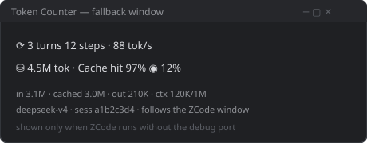
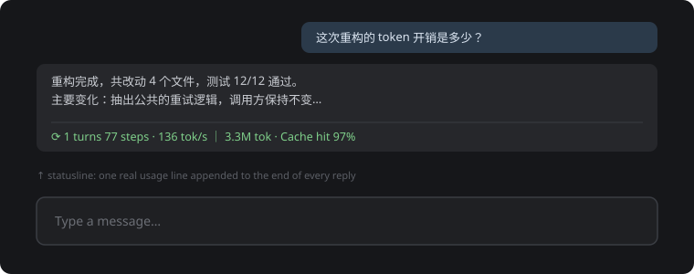
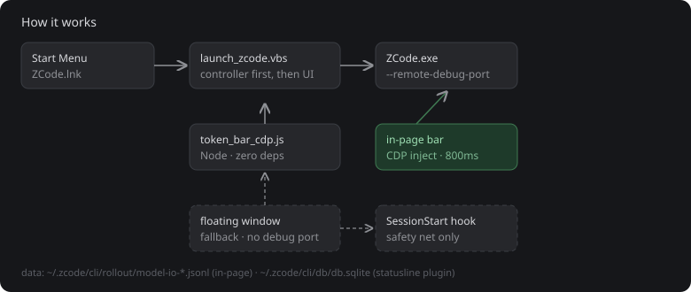

# ZcodeTokbar · ZCode 用量显示工具集

<div align="center">

一套让 ZCode 的 token 开销**看得见**的开源小工具：输入框下方的实时用量条 + 每条回复末尾的状态栏行。

A tiny open-source toolkit that makes ZCode token usage **visible**: a live usage bar under the input box + a status line at the end of every reply.

[中文](#中文说明) · [English](#english) · [功能截图](#-功能截图--screenshots) · [打赏](#-打赏--donate)

  

</div>

---

## 📸 功能截图 / Screenshots

### 1. 页内用量条（主模式 · in-page bar）

输入框正下方、跟随 ZCode 主题的一条实时统计：轮次 / 步数 / 速率 / 累计 token / 缓存命中 / 上下文占用环。

Live stats injected right under ZCode's input box, themed with ZCode's own CSS variables.


```
⟳  2 turns 59 steps · 196 tok/s   ⛁  21.1M tok · Cache hit 49%   ◉  27%
```

悬停可看明细：`in / cached / out / 上下文绝对值 / 模型 / 会话号`。
Hover for details: `in / cached / out / absolute ctx / model / session`.

### 2. 悬浮小窗（回退模式 · fallback window）

当 ZCode 没带调试端口启动（例如更新器改回了快捷方式）时，自动降级为贴在窗口下方的小窗，端口恢复后自动切回页内条。

When ZCode starts without the debug port, it falls back to a small window under the ZCode window, and switches back automatically once the port appears.



### 3. 回复末尾状态栏（插件 · statusline plugin）

```
⟳ 1 turns 77 steps · 136 tok/s ｜ 3.3M tok · Cache hit 97%
```



### 4. 工作原理（架构 · how it works）



---

## 中文说明

### 这是什么

本仓库包含**两套互补**的工具，解决同一件事：ZCode 原生界面不显示 token 用量。

| 工具 | 位置 | 数据源 | 适合谁 |
|---|---|---|---|
| **页内用量条**（`scripts/`） | 输入框正下方（CDP 注入） | `~/.zcode/cli/rollout/model-io-*.jsonl` | Windows 日常使用者，想要"像内置功能一样"的实时条 |
| **状态栏插件**（`zcode-statusline/`） | 每条回复的最后一行 | `~/.zcode/cli/db/db.sqlite`（只读） | 想要跨平台、可进插件市场分发的轻量方案 |

两者可单独使用，也可同时使用（同时开会有两行，可按需关掉其中一个）。

### 口径（两套工具一致）

| 显示 | 含义 |
|---|---|
| `N turns M steps` | 用户发了几轮 / 模型请求次数（含工具循环的每一步；插件版步数=本轮工具调用数） |
| `tok/s` | 输出速率（页内版=当前轮平均；插件版=本轮纯生成耗时加权） |
| `N tok` | 会话累计 token（输入已含缓存命中部分，不重复计算） |
| `Cache hit N%` | 缓存读取 ÷ 输入总量（与 ZCode 的 Average cache hit rate 一致） |
| `◉ N%` / 环形圈 | 最近一次请求的输入 ÷ 模型上下文窗口 |

关键细节（都已在真实数据库上核对过）：`input_tokens` 已包含 `cache_read_input_tokens`（命中率直接相除即可）；`output_tokens` 已包含 `reasoning_tokens`（算速率不要重复相加）。

### 快速开始

#### A. 页内用量条（Windows）

```cmd
scripts\deploy-local.cmd
```

它会把 `scripts\` 复制到 `%USERPROFILE%\.zcode\tools\token-bar`（避开网盘同步目录），再运行安装：探测 `node` / `ZCode.exe` / `pythonw` → 写 `paths.ini` → 注册 `SessionStart` hook → 把开始菜单快捷方式指向启动器。之后**从开始菜单启动 ZCode**，约 2 秒后输入框下方出现统计条。

| 目的 | 操作 |
|---|---|
| 安装 / 重装 / 修复 | `scripts\deploy-local.cmd`（推荐）或 `scripts\install.cmd` |
| 手动启动 / 停止 | `scripts\start.cmd` / `scripts\stop.cmd` |
| 只打印统计不开界面 | `node scripts\token_bar_cdp.js --dump` |
| 卸载还原 | `scripts\uninstall.cmd` |

#### B. 状态栏插件（跨平台）

1. 打开 **插件市场 → 添加 → 添加插件市场**，粘贴本仓库地址（`marketplace.json` 所在目录）；
2. 在 **zcode-tokbar → zcode-statusline → 安装**；
3. **重开会话**（钩子在会话启动时注册），此后每条回复末尾出现状态栏行。

`/status` 命令可随时手动打印一次（验证安装）。关闭显示：`~/.zcode/statusline.config.json` 写 `{ "statusline": false }`。

### 环境变量 / 配置

| 变量 | 默认 | 说明 |
|---|---|---|
| `ZCTB_CDP_PORT` | `9333` | ZCode 调试端口（`launch_zcode.vbs` 会跟随该变量，需与控制器一致） |
| `ZCTB_SINGLETON_PORT` | `9334` | 控制器单实例端口 |
| `ZCTB_PORT_WAIT_MS` | `20000` | 等不到调试端口时，多久后回退悬浮窗 |
| `ZCTB_FLOAT` | `1` | 设为 `0` 禁用悬浮回退（只等页内模式） |
| `ZCTB_POLL_MS` | `800` | 刷新间隔 |
| `ZCTB_PYTHONW` | 自动探测 | 指定 `pythonw.exe`（悬浮回退用） |
| `ZCODE_USAGE_DB` | `~/.zcode/cli/db/db.sqlite` | 状态栏插件的数据库路径覆盖 |
| `STATUSLINE_MIN_MS` | `200` | 状态栏速率样本的最小生成耗时（毫秒） |

### 排查

先看 `controller.log`（与脚本同目录，自动轮转 512KB）。

| 现象 | 原因 / 处理 |
|---|---|
| 完全没有条 | 控制器没在跑 → `start.cmd`；确认日志有 `controller started`；确认从开始菜单启动 |
| 只有悬浮小窗 | ZCode 没带 `--remote-debugging-port` → 重跑 `install.cmd`；控制器每 5 分钟会尝试自愈快捷方式 |
| 条在但数字不动 | 当前会话没有新请求；页内版只跟随界面**当前显示的会话**，认不出时显示 waiting（不会拿别的会话顶上） |
| ZCode 升级后条消失 | `[data-testid="v4-composer"]` 可能变了 → 更新 `token_bar_cdp.js` 里 `SNIPPET` 的选择器 |
| 回复末尾没有状态栏行 | 会话是旧会话（钩子没注册）→ 重开会话；或模型被要求"不要附加任何内容"（有意保留的逃生门） |
| 同时出现两行 | 页内条 + 插件行同时开着 → 按需关一个（插件：`{ "statusline": false }`） |

### 卸载 / 还原

运行 `scripts\uninstall.cmd`：停进程 → 恢复开始菜单快捷方式 → 移除 hook → 删桌面快捷方式。备份（`ZCode.lnk.backup`、`config.json.token-bar.bak`）保留在安装目录，确认无误后可连目录一起删除。

### 安全与隐私

- 调试端口只监听 `127.0.0.1`，外部网络访问不到；副作用是本机其它程序理论上可连该端口读取页面内容，不需要时卸载即可彻底关闭。
- 本工具**只读** ZCode 本地的会话日志与 usage 库，不上传任何数据；`--dump` / `--json` 输出仅打印到本地终端。
- 公开版已脱敏：仓库内无任何绝对路径与个人信息。所有本机路径均在**运行时动态探测**（`paths.ini` 由安装器生成且已加入 `.gitignore`，`os.homedir()` / `%LOCALAPPDATA%` / `%ProgramFiles%` / `%APPDATA%` 解析目录，`ZCODE_PLUGIN_ROOT` 解析插件位置），不会硬编码用户名、盘符或网盘目录。

### 目录结构

```
ZcodeTokbar/
├── README.md                  本文件（中英双语）
├── SKILL.md                   技能清单（可被 ZCode 作为 skill 加载）
├── LICENSE                    MIT
├── marketplace.json           本地插件市场（zcode-tokbar → zcode-statusline）
├── assets/                    功能示意图与打赏占位图
│   ├── bar-inpage.svg         页内用量条示意
│   ├── bar-float.svg          悬浮小窗示意
│   ├── statusline-reply.svg   回复末尾状态栏示意
│   ├── arch.svg               架构图
│   └── donate-alipay.svg      支付宝占位（替换为你的收款码）
├── scripts/                   页内用量条（Windows）
│   ├── token_bar_cdp.js       控制器：CDP 注入 + 回退管理（Node，零依赖）
│   ├── token_bar.py           悬浮小窗（回退模式；仅标准库）
│   ├── launch_zcode.vbs       启动器：先起控制器，再带调试端口启动 ZCode
│   ├── ensure-shortcut.vbs    快捷方式自愈（更新器改回后修回来）
│   ├── install.cmd            一键安装 / 修复（幂等）
│   ├── deploy-local.cmd       推荐入口：复制到本地目录再安装
│   ├── uninstall.cmd          卸载还原
│   ├── start.cmd / stop.cmd   手动启停
│   ├── setup.js               读写 SessionStart hook（幂等）
│   └── shortcuts.ps1          创建 / 还原快捷方式
└── zcode-statusline/          状态栏插件（跨平台）
    ├── .zcode-plugin/plugin.json
    ├── hooks/                 UserPromptSubmit → prompt-submit.mjs
    ├── scripts/statusline.mjs 核心：读 usage 库算出一行
    ├── commands/status.md     /status 命令
    └── test/statusline.test.mjs（node --test，6 项口径测试）
```

---

## English

### What is this

Two complementary tools that answer one question: *how many tokens did that cost?* ZCode's native UI doesn't show it.

| Tool | Where | Data source | For whom |
|---|---|---|---|
| **In-page bar** (`scripts/`) | Right under the input box (CDP injection) | `~/.zcode/cli/rollout/model-io-*.jsonl` | Windows daily users who want a built-in-looking live bar |
| **Statusline plugin** (`zcode-statusline/`) | Last line of every reply | `~/.zcode/cli/db/db.sqlite` (read-only) | Anyone wanting a portable, marketplace-distributable option |

Use either one alone, or both (both enabled = two lines; turn one off if you prefer a single line).

### Metrics (shared caliber)

- `N turns M steps` — user rounds / model requests (plugin counts tool calls of the current turn as steps).
- `tok/s` — output rate (in-page: current-turn average; plugin: generation-time-weighted).
- `N tok` — session total (`input_tokens` already includes cache reads — never double-count).
- `Cache hit N%` — cache reads ÷ total input (matches ZCode's *Average cache hit rate*).
- Ring / `◉ N%` — last request input ÷ model context window.

Verified against real databases: `input_tokens` already includes `cache_read_input_tokens`; `output_tokens` already includes `reasoning_tokens` (don't add them again or the rate nearly doubles).

### Quick start

**A. In-page bar (Windows):**

```cmd
scripts\deploy-local.cmd
```

It copies `scripts\` to `%USERPROFILE%\.zcode\tools\token-bar` (avoids cloud-sync folders), then installs: probes `node` / `ZCode.exe` / `pythonw` → writes `paths.ini` → registers the `SessionStart` hook → repoints the Start Menu shortcut. Launch ZCode **from the Start Menu**; the bar appears under the input box in ~2 seconds.

**B. Statusline plugin (cross-platform):**

1. **Plugin marketplace → Add → Add marketplace**, paste this repo URL (where `marketplace.json` lives);
2. Install **zcode-tokbar → zcode-statusline**;
3. **Start a new session** (hooks register at session start). Every reply then ends with the status line.

`/status` prints it on demand. Disable with `{ "statusline": false }` in `~/.zcode/statusline.config.json`.

See [configuration](#环境变量--配置) and [troubleshooting](#排查) above — variable names are identical in both languages.

### Security & privacy

- The debug port binds `127.0.0.1` only — unreachable from the network. Any local program could theoretically attach to it; uninstall fully closes the channel.
- Everything is **read-only** against local ZCode logs/databases; nothing is uploaded. `--dump` / `--json` print to your terminal only.
- This public copy contains **no absolute paths or personal info**. All machine-specific paths resolve at runtime (`paths.ini` is generated by the installer and git-ignored; directories come from `os.homedir()` / `%LOCALAPPDATA%` / `%ProgramFiles%` / `%APPDATA%`; plugin location from `ZCODE_PLUGIN_ROOT`). No usernames, drive letters, or cloud-sync folders are hardcoded.

---

## ☕ 打赏 / Donate

如果这个小工具帮你省下了 token 焦虑，欢迎请作者喝杯咖啡。

If it saves you from token anxiety, consider buying the author a coffee.

| 支付宝 Alipay | 说明 |
|---|---|
|  | 把你的收款码存为 `assets/alipay.png`（240×320 以上），再把上表这行换成 `` 即可生效 |

> 占位图为 SVG，GitHub 可直接渲染；正式发布前记得替换为真实收款码 PNG。
> The placeholder is an SVG that GitHub renders inline; replace it with your real QR PNG before publishing.

---

## License

MIT — see [LICENSE](./LICENSE).
