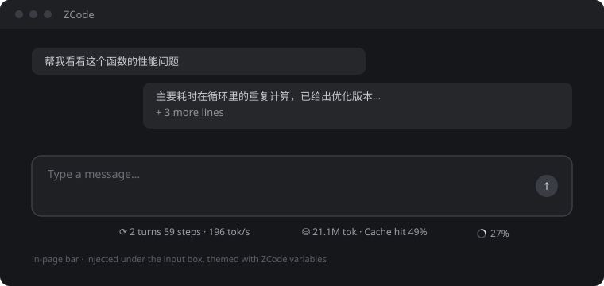
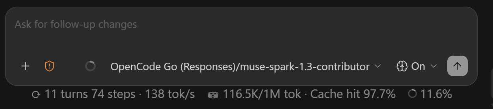

# ZcodeTokbar

**English** | [简体中文](README.zh.md)

[](https://www.microsoft.com/windows) [](https://nodejs.org/) [](LICENSE)

Live token usage for ZCode, two flavours: a real-time bar under the input box (Windows, CDP injection) and a one-line statusline at the end of every reply (marketplace plugin).



```
⟳ 2 turns 59 steps · 196 tok/s ⛁ 21.1M tok · Cache hit 49% ◉ 27%
```



## Quick start

- **In-page bar (Windows):** run `scripts\deploy-local.cmd`, then launch ZCode from the Start Menu.
- **Statusline plugin:** add this repo as a marketplace, install `zcode-statusline`, and start a new session. `/status` prints it on demand.

Numbers come straight from ZCode's local logs/usage DB (read-only): turns/steps, tok/s, session tokens, cache-hit rate, context %.

---

## Buy Me a Coffee / Support

If ZcodeTokbar saved you from token anxiety, feel free to support the developer! ☕


